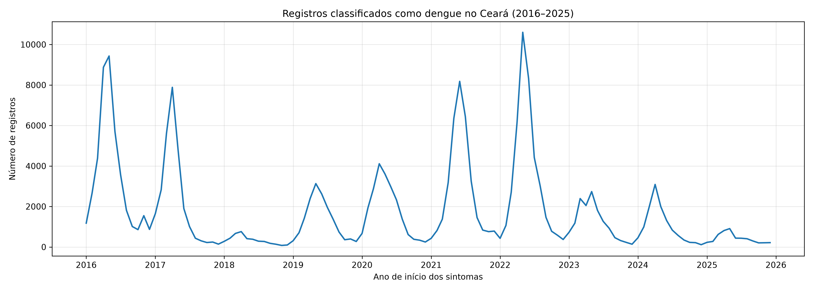
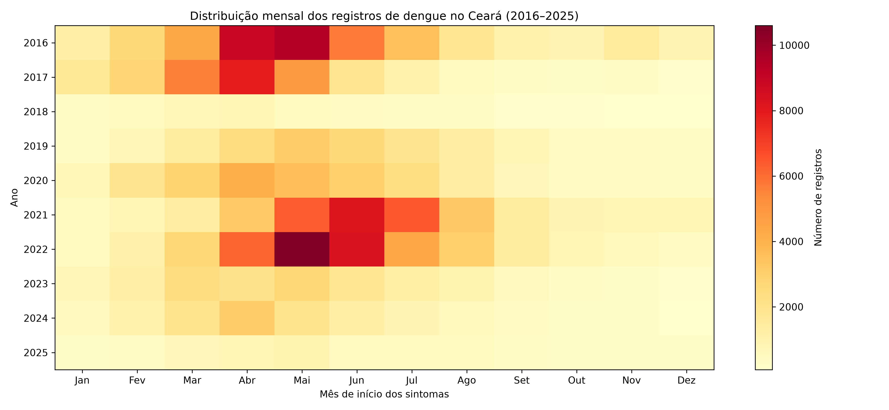

# 🦟 Análise Temporal e Espacial da Dengue no Ceará (2016–2025)

**Trabalho de Conclusão de Curso (TCC) — Ciência da Computação**

🎓 Instituto Federal de Educação, Ciência e Tecnologia do Ceará (IFCE) — Campus Maracanaú.

## 📖 Sobre o projeto

Este projeto tem como objetivo analisar a distribuição temporal e espacial dos registros classificados como dengue no estado do Ceará, entre 2016 e 2025, utilizando Python e dados públicos do Ministério da Saúde.

A pesquisa busca identificar tendências temporais, padrões de sazonalidade e diferenças na distribuição dos registros entre os municípios cearenses.

**Status:** 🚧 Em desenvolvimento — análise temporal exploratória concluída e análise espacial em preparação.

## 🎯 Objetivos

### Objetivo geral

Analisar a distribuição temporal e espacial da dengue no Ceará entre 2016 e 2025, utilizando técnicas de processamento, análise e visualização de dados.

### Objetivos específicos

- Preparar e consolidar os dados públicos de dengue.
- Avaliar a qualidade dos registros disponíveis.
- Identificar tendências temporais e padrões sazonais.
- Investigar a distribuição dos registros entre os municípios.
- Produzir tabelas, gráficos e visualizações para apoiar a interpretação dos resultados.

## 🗃️ Fonte dos dados

Os dados foram obtidos no portal de dados abertos do Ministério da Saúde, a partir dos arquivos nacionais de dengue referentes ao período de 2016 a 2025.

**Fonte oficial:** https://dadosabertos.saude.gov.br/dataset/arboviroses-dengue

Os arquivos originais seguem o padrão `DENGBR16.csv` até `DENGBR25.csv`.

## Base populacional histórica do Ceará (2016–2025)

Para permitir a comparação dos registros de dengue entre municípios com diferentes tamanhos populacionais, foi construída uma base histórica de população dos 184 municípios do Ceará, abrangendo o período de 2016 a 2025.

### Fontes dos dados

Os dados populacionais foram obtidos de publicações oficiais do Instituto Brasileiro de Geografia e Estatística (IBGE):

- **2016–2021:** estimativas anuais de população municipal.
- **2022:** população residente do Censo Demográfico 2022, obtida na tabela 4714 do SIDRA/IBGE.
- **2023:** população do Censo 2022 disponibilizada com referência à malha municipal de 2023.
- **2024–2025:** estimativas anuais de população municipal.

### Processamento

O processamento é realizado pelo script `scripts/preparar_populacao_historica.py`, responsável por:

1. Ler os arquivos populacionais originais do IBGE.
2. Selecionar os municípios do Ceará, identificados pelo código da unidade federativa 23.
3. Padronizar os códigos municipais do IBGE com sete dígitos.
4. Consolidar os dados em uma única estrutura histórica.
5. Validar a quantidade de municípios, a unicidade dos códigos, a integridade das populações e os totais estaduais.

O arquivo gerado é:

`dados/processados/populacao_ceara_historica.csv`

**Estrutura:** 1.840 registros, correspondentes a 184 municípios em 10 anos.

**Campos:** `CODIGO_IBGE`, `ANO`, `MUNICIPIO` e `POPULACAO`.

### Particularidade dos dados de 2022 e 2023

As bases de 2022 e 2023 apresentam a mesma população estadual, de 8.794.957 habitantes, mas foram identificadas diferenças em dois municípios:

| Município | População 2022 | População 2023 | Diferença |
|---|---:|---:|---:|
| Ereré | 6.474 | 6.247 | -227 |
| Pereiro | 15.274 | 15.501 | +227 |

As diferenças se compensam no total estadual. Os valores originais foram preservados, sem ajustes manuais.

A hipótese de redistribuição populacional associada à referência territorial de 2023 ainda depende de confirmação documental do IBGE.

**Nota metodológica:** os dados de 2023 não representam uma estimativa populacional independente do Censo 2022. Essa particularidade deverá ser considerada na interpretação das taxas anuais.

### Aplicação na pesquisa

A base populacional será utilizada como denominador no cálculo das taxas anuais de registros classificados de dengue por 100 mil habitantes, permitindo comparações temporais e espaciais entre os municípios cearenses.

Essas taxas serão indicadores derivados da base analítica utilizada no estudo e não devem ser apresentadas automaticamente como incidência oficial de dengue.

## 🛠️ Tecnologias utilizadas

- 🐍 Python — processamento e análise dos dados.
- 🐼 Pandas — manipulação de tabelas e séries temporais.
- 📊 Matplotlib — geração de gráficos e visualizações.
- 💻 Visual Studio Code — ambiente de desenvolvimento.
- 🌿 Git e GitHub — versionamento e documentação.

## 📂 Estrutura do projeto

```text
TCC_Dengue_Ceara/
├── artigo/
│   ├── diario_pesquisa.md
│   └── rascunho.md
├── dados/
│   ├── originais/
│   └── processados/
├── resultados/
│   ├── graficos/
│   └── serie_historica_mensal.csv
├── scripts/
│   ├── preparar_base_historica.py
│   ├── consolidar_base_historica.py
│   ├── criar_base_analitica.py
│   ├── validar_base_analitica.py
│   ├── analisar_datas_sintomas.py
│   ├── serie_historica_mensal.py
│   ├── grafico_serie_mensal.py
│   ├── analisar_sazonalidade.py
│   ├── analisar_picos_anuais.py
│   └── grafico_mapa_calor.py
├── .gitignore
└── README.md
```

A estrutura destaca os principais arquivos utilizados no fluxo atual. Outros scripts exploratórios e de validação também fazem parte do desenvolvimento.

Os arquivos CSV de dados são mantidos localmente e não são versionados no repositório.

## 🔬 Metodologia

### 1. Preparação dos dados

Os arquivos nacionais foram processados para selecionar os registros referentes ao Ceará, identificado pelo código `SG_UF = 23`.

A consolidação dos arquivos de 2016 a 2025 resultou em **416.095 registros**.

### 2. Seleção dos registros classificados como dengue

Foram selecionados os registros cuja variável `CLASSI_FIN` apresenta os seguintes códigos:

| Código | Classificação |
|---|---|
| 10 | Dengue |
| 11 | Dengue com sinais de alarme |
| 12 | Dengue grave |

Essa seleção resultou em **215.748 registros**.

### 3. Definição do período temporal

A variável `DT_SIN_PRI`, correspondente à data de início dos primeiros sintomas, foi adotada como referência principal para a análise temporal.

Foram identificados 435 registros com início dos sintomas fora do período de 2016 a 2025.

Esses registros foram preservados na base histórica, mas não incluídos na base analítica do período estudado.

A base analítica resultante contém **215.313 registros**.

### 4. Controle de qualidade temporal

Foi calculado o intervalo entre o início dos sintomas (`DT_SIN_PRI`) e a data de notificação (`DT_NOTIFIC`).

Entre os 215.313 registros da base analítica, foram identificados:

| Intervalo | Registros |
|---|---:|
| 0 a 30 dias | 211.881 |
| 31 a 365 dias | 3.370 |
| Superior a 365 dias | 62 |
| Negativo ou ausente | 0 |

Os 62 registros com intervalo superior a 365 dias foram sinalizados pela variável `ATRASO_EXTREMO`.

Esses registros permaneceram preservados na base analítica, mas foram desconsiderados nos scripts de análise temporal.

Assim, a série histórica temporal foi construída com **215.251 registros**.

Esse critério constitui uma decisão metodológica de controle de qualidade e não representa confirmação de erro nos registros.

### 5. Investigação de possíveis duplicidades

Foram investigadas combinações de atributos repetidos nos registros.

Como os arquivos analisados não apresentaram um identificador individual suficiente para confirmar duplicidades, não foram realizadas exclusões automáticas com base nessas coincidências.

Registros com atributos idênticos não foram considerados necessariamente casos duplicados.

## 📊 Resultados preliminares

### 📈 Distribuição anual

A análise temporal considerou 215.251 registros classificados como dengue, distribuídos entre 2016 e 2025.

| Ano | Registros |
|---|---:|
| 2016 | 41.894 |
| 2017 | 27.055 |
| 2018 | 3.995 |
| 2019 | 15.674 |
| 2020 | 21.451 |
| 2021 | 33.845 |
| 2022 | 39.940 |
| 2023 | 14.220 |
| 2024 | 12.128 |
| 2025 | 5.049 |
| **Total** | **215.251** |

Os maiores totais anuais foram observados em 2016 e 2022.

### 🌦️ Sazonalidade

A análise dos registros mensais identificou maior concentração entre março e junho, período responsável por aproximadamente **65,5%** dos registros analisados.

Maio apresentou a maior média mensal da série, com 4.401,8 registros.

Os meses de pico anual foram:

- Maio: 5 anos.
- Abril: 4 anos.
- Junho: 1 ano.

Em todos os dez anos estudados, o maior total mensal ocorreu entre abril e junho.

O maior pico de toda a série foi observado em **maio de 2022, com 10.601 registros**.

### 📉 Série histórica mensal



*Figura 1 — Distribuição mensal dos registros classificados como dengue no Ceará, de 2016 a 2025, segundo o início dos sintomas.*

### 🔥 Mapa de calor temporal



*Figura 2 — Distribuição mensal dos registros classificados como dengue no Ceará, por ano e mês de início dos sintomas.*

O mapa de calor permite identificar períodos de maior concentração e comparar visualmente as diferenças entre os anos.

### 🗺️ Análise espacial

🚧 **Em desenvolvimento.**

Esta etapa investigará a distribuição dos registros por município de residência, utilizando a variável `ID_MN_RESI`.

Estão previstas análises comparativas entre municípios e, quando disponíveis os denominadores populacionais adequados, o cálculo de taxas de incidência.

## ⚙️ Como executar

### Pré-requisitos

- Python 3
- Pandas
- Matplotlib

Instale as bibliotecas necessárias:

```bash
python -m pip install pandas matplotlib
```

Os arquivos de dados devem estar disponíveis nos diretórios locais correspondentes.

Execute os comandos a partir da pasta raiz do projeto.

### Preparação da base analítica

```bash
python scripts/criar_base_analitica.py
python scripts/validar_base_analitica.py
```

### Análise temporal

```bash
python scripts/serie_historica_mensal.py
python scripts/grafico_serie_mensal.py
python scripts/analisar_sazonalidade.py
python scripts/analisar_picos_anuais.py
python scripts/grafico_mapa_calor.py
```

Os gráficos gerados são armazenados em `resultados/graficos/`.

## ⚠️ Limitações

Os resultados correspondem aos registros disponíveis nos arquivos analisados e não devem ser interpretados automaticamente como números de pessoas únicas, casos confirmados individualmente ou taxas de incidência.

A completude dos dados, especialmente em 2025, ainda precisa ser avaliada.

Também está prevista uma análise de sensibilidade para verificar o efeito da desconsideração dos 62 registros com intervalos extremos.

As diferenças entre os anos podem refletir tanto variações epidemiológicas quanto características dos dados disponibilizados.

## 🚀 Próximas etapas

- [x] Obter os dados públicos de dengue de 2016 a 2025.
- [x] Filtrar os registros referentes ao Ceará.
- [x] Consolidar a base histórica.
- [x] Investigar possíveis duplicidades.
- [x] Validar classificações e datas.
- [x] Criar a base analítica.
- [x] Construir a série histórica mensal.
- [x] Investigar a sazonalidade e os picos anuais.
- [x] Gerar o gráfico temporal e o mapa de calor.
- [ ] Validar os códigos dos municípios.
- [ ] Realizar a análise espacial.
- [ ] Avaliar taxas populacionais.
- [ ] Verificar a completude dos dados de 2025.
- [ ] Realizar análises de sensibilidade.
- [ ] Consolidar os resultados no artigo científico.

## 🎓 Instituição

**Instituto Federal de Educação, Ciência e Tecnologia do Ceará (IFCE)**

Campus Maracanaú — Curso de Ciência da Computação.

## 🔗 Repositório

https://github.com/souiuri/TCC_Dengue_Ceara

---

*Projeto acadêmico em desenvolvimento, utilizando dados públicos para fins de pesquisa científica.*