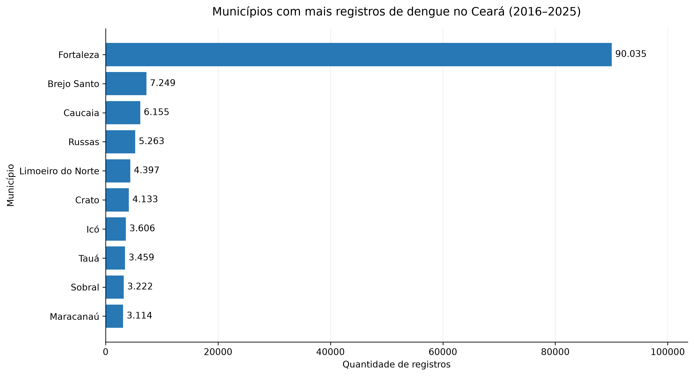

# Análise Temporal e Espacial da Dengue no Estado do Ceará entre 2016 e 2025 Utilizando Python

**Trabalho de Conclusão de Curso — Ciência da Computação**

**Instituição:** Instituto Federal de Educação, Ciência e Tecnologia do Ceará (IFCE) — Campus Maracanaú

**Situação:** Rascunho inicial do artigo científico

**Orientador:** Prof. Fabio Jose Gomes de Sousa

## Resumo

*A elaborar após a conclusão das análises e da discussão dos resultados.*

**Palavras-chave provisórias:** Dengue. Análise de Dados. Séries Temporais. Python. Saúde Pública.

## 1. Introdução

A dengue representa um importante desafio para a saúde pública brasileira, exigindo estratégias de vigilância epidemiológica e acompanhamento de sua distribuição ao longo do tempo e do espaço.

A disponibilidade de bases públicas de dados epidemiológicos permite o desenvolvimento de estudos computacionais voltados à investigação de padrões de ocorrência de doenças. Nesse contexto, ferramentas de programação e análise de dados podem contribuir para a organização, o processamento e a visualização de informações epidemiológicas.

Este trabalho propõe analisar os registros de dengue no estado do Ceará entre 2016 e 2025, considerando sua distribuição temporal e espacial, a distinção entre notificações e casos confirmados e a identificação de tendências ao longo do período.

### 1.1 Objetivo geral

Analisar a evolução temporal e a distribuição espacial dos registros de dengue no estado do Ceará entre 2016 e 2025, utilizando técnicas computacionais de processamento e análise de dados.

### 1.2 Objetivos específicos

- Processar e organizar os dados históricos de dengue.
- Avaliar a qualidade e a consistência dos registros.
- Identificar notificações e casos confirmados conforme critérios oficiais.
- Investigar a distribuição anual e mensal dos registros.
- Analisar a distribuição dos registros entre os municípios cearenses.
- Identificar tendências temporais e padrões sazonais.

## 2. Fundamentação teórica

*A desenvolver mediante levantamento bibliográfico.*

Temas previstos:

- Dengue e vigilância epidemiológica.
- Sistemas de informação em saúde.
- Qualidade de dados epidemiológicos.
- Análise exploratória de dados.
- Séries temporais e sazonalidade.

## 3. Metodologia

### 3.1 Caracterização da pesquisa

O estudo propõe uma abordagem quantitativa, de caráter observacional e retrospectivo, baseada na análise de dados secundários disponibilizados publicamente.

### 3.2 Fonte e período dos dados

Serão utilizados dados históricos de dengue disponibilizados pelo Ministério da Saúde, abrangendo os arquivos de origem de 2016 a 2025.

A área geográfica de interesse é o estado do Ceará, identificado pelo código 23 na variável `SG_UF`.

### 3.3 Ferramentas computacionais

O processamento será realizado em Python, com utilização da biblioteca pandas para manipulação de dados e Matplotlib para visualização gráfica.

### 3.4 Preparação dos dados

Os arquivos históricos são processados por meio de leitura em blocos, permitindo a manipulação de grandes volumes de registros.

A filtragem geográfica seleciona os registros referentes ao Ceará. As bases originais são preservadas separadamente dos arquivos processados.

### 3.5 Avaliação da qualidade dos dados

Será avaliada a consistência das datas de notificação (`DT_NOTIFIC`) e de início dos sintomas (`DT_SIN_PRI`), incluindo a identificação de intervalos inconsistentes, datas inválidas e registros potencialmente duplicados.

A definição dos critérios de inclusão e exclusão será documentada antes da consolidação da base analítica.

A classificação dos registros será investigada por meio da variável `CLASSI_FIN`, utilizando como referência o Dicionário de Dados do SINAN Online e a Nota Informativa nº 59/2016 do Ministério da Saúde. Serão considerados inicialmente como registros classificados como dengue aqueles identificados pelos códigos 10 (dengue), 11 (dengue com sinais de alarme) e 12 (dengue grave). A variável `CRITERIO` será utilizada para avaliar o critério de confirmação ou descarte, distinguindo registros laboratoriais, clínico-epidemiológicos e aqueles marcados como em investigação. A definição final da base analítica dependerá da investigação de classificações não documentadas, possíveis duplicidades e inconsistências temporais.

### 3.6 Análise temporal e espacial

A análise contemplará a distribuição anual e mensal das notificações e dos casos confirmados, além de comparações entre municípios, considerando dados populacionais quando aplicável.

### 3.6.1 Dados populacionais e padronização das taxas

Para permitir a comparação da distribuição dos registros de dengue entre municípios de diferentes tamanhos populacionais, foi construída uma base histórica de população municipal do Ceará, abrangendo o período de 2016 a 2025.

Os dados foram obtidos de publicações oficiais do Instituto Brasileiro de Geografia e Estatística (IBGE). Para os anos de 2016 a 2021 e de 2024 a 2025, foram utilizadas estimativas populacionais municipais. Para 2022, foram utilizados os dados de população residente do Censo Demográfico 2022, disponibilizados na tabela 4714 do SIDRA/IBGE. Para 2023, foi utilizada a publicação censitária referente à malha municipal daquele ano.

O processamento foi realizado em Python, com auxílio da biblioteca pandas, por meio do script `preparar_populacao_historica.py`. Os arquivos foram padronizados utilizando os códigos municipais de sete dígitos do IBGE e consolidados em uma base contendo 1.840 observações, correspondentes aos 184 municípios cearenses durante dez anos.

Foram realizadas verificações de integridade, incluindo unicidade dos códigos municipais por ano, ausência de populações inválidas e consistência dos totais estaduais.

Na comparação das bases de 2022 e 2023, identificaram-se diferenças populacionais nos municípios de Ereré e Pereiro, com variações de -227 e +227 habitantes, respectivamente. O total estadual permaneceu inalterado. Os valores originais foram preservados, considerando-se a necessidade de investigar eventuais diferenças de referência territorial.

Após a integração da base populacional aos registros classificados de dengue, será calculada a taxa anual de registros por 100 mil habitantes:

\[
T_{m,a}=\frac{R_{m,a}}{P_{m,a}}\times100.000
\]

Em que:

- \(T_{m,a}\): taxa de registros classificados de dengue por 100 mil habitantes no município \(m\), no ano \(a\).
- \(R_{m,a}\): quantidade de registros classificados de dengue no município \(m\), no ano \(a\).
- \(P_{m,a}\): população utilizada como denominador para o município \(m\), no ano \(a\).

As taxas calculadas serão interpretadas como indicadores derivados da base analítica do estudo, não sendo automaticamente equivalentes aos indicadores oficiais de incidência de dengue.

A utilização de dados censitários e estimativas populacionais de diferentes referências temporais e territoriais constitui uma limitação metodológica a ser considerada na comparação entre anos.

### 3.7 Análise de tendências

Na etapa final, serão aplicadas técnicas de análise de séries temporais para investigar tendências e padrões sazonais. Os métodos estatísticos específicos serão definidos após a consolidação e avaliação da qualidade da série histórica.

## 4. Resultados e discussão

### 4.1. Resultados preliminares — Análise temporal

A análise temporal compreendeu 215.251 registros classificados como dengue no Ceará, com início dos sintomas entre 2016 e 2025, após a aplicação dos critérios de seleção temporal e desconsideração dos registros com atrasos de notificação superiores a 365 dias.

A distribuição anual apresentou variações expressivas ao longo do período estudado. O maior total foi observado em 2016, com 41.894 registros, seguido por 2022, com 39.940. Em contrapartida, 2018 apresentou 3.995 registros, o menor total entre 2016 e 2024.

A análise da sazonalidade revelou maior concentração dos registros entre março e junho, correspondendo a aproximadamente 65,5% do total analisado. Maio apresentou a maior média mensal, com 4.401,8 registros.

A avaliação dos picos anuais demonstrou que o mês de maior ocorrência se concentrou entre abril e junho em todos os anos estudados. O maior pico mensal da série foi identificado em maio de 2022, com 10.601 registros.

Esses resultados indicam um padrão sazonal nos registros analisados, embora sejam necessárias avaliações adicionais sobre a completude e a representatividade dos dados para sustentar interpretações epidemiológicas mais amplas.

### 4.2. Resultados preliminares — Análise espacial

A validação dos códigos municipais identificou registros referentes aos 184 municípios do Ceará, totalizando 215.243 registros com município cearense válido entre 2016 e 2025. A distribuição dos valores absolutos apresentou concentração expressiva em Fortaleza, responsável por 41,83% dos registros municipais, seguida por Brejo Santo (3,37%) e Caucaia (2,86%).

A Figura 3 apresenta os dez municípios com maiores quantidades acumuladas de registros classificados como dengue no período analisado.

*Figura 3 — Dez municípios com maiores quantidades de registros classificados como dengue no Ceará, entre 2016 e 2025. Fonte: elaboração própria, com dados do Ministério da Saúde.*

Esses resultados constituem uma caracterização espacial preliminar. A incorporação de dados populacionais será necessária para comparar adequadamente as taxas entre municípios.

## 5. Conclusão

*A elaborar após a análise e discussão dos resultados.*

## Referências

*A construir com base nas fontes oficiais e nos trabalhos científicos consultados.*

Fonte inicial dos dados:

MINISTÉRIO DA SAÚDE. Portal de Dados Abertos — Arboviroses: Dengue. Disponível em: https://dadosabertos.saude.gov.br/dataset/arboviroses-dengue.

*Referência bibliográfica a normalizar conforme as orientações institucionais.*
