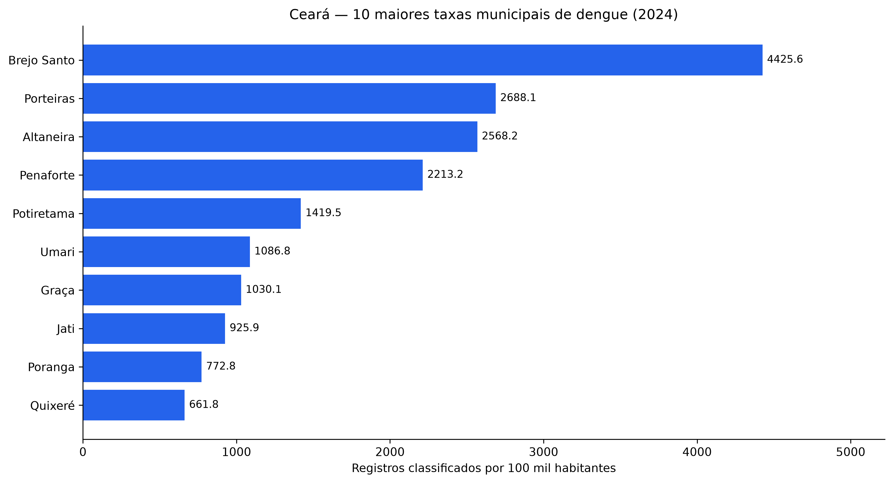
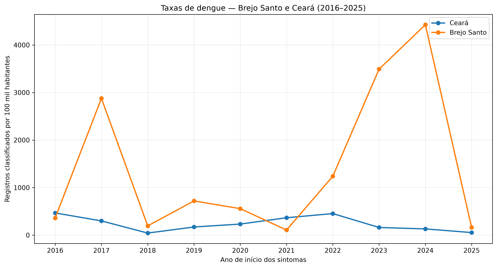
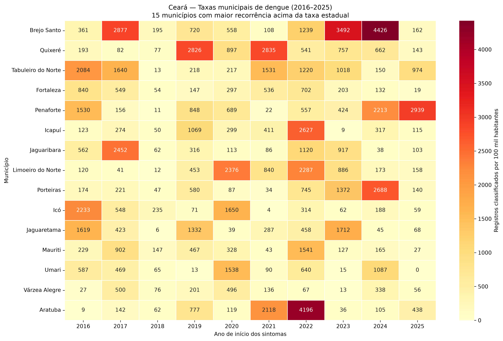

# Análise Temporal e Espacial da Dengue no Estado do Ceará entre 2016 e 2025 Utilizando Python

**Trabalho de Conclusão de Curso — Ciência da Computação**  
**Instituição:** Instituto Federal de Educação, Ciência e Tecnologia do Ceará (IFCE) — Campus Maracanaú  
**Orientador:** Prof. Fabio Jose Gomes de Sousa  
**Situação:** Rascunho de artigo científico em desenvolvimento; resultados sujeitos a validação metodológica e revisão bibliográfica.

## Resumo

*A redigir após a consolidação das análises, discussão e conclusão.*

**Palavras-chave provisórias:** Dengue. Análise de dados. Séries temporais. Python. Saúde pública.

## 1. Introdução

A dengue constitui um desafio para a saúde pública brasileira e demanda acompanhamento de sua distribuição temporal e geográfica. Bases públicas de vigilância epidemiológica possibilitam análises computacionais que auxiliam na descrição de padrões de registros, na identificação de inconsistências e na comparação de municípios com diferentes populações.

Este estudo examina os registros classificados como dengue no Ceará entre 2016 e 2025, com base em arquivos históricos do Ministério da Saúde. Diferenciam-se as notificações disponíveis nos arquivos de origem dos registros selecionados por classificação final e qualidade temporal. Os resultados não são tratados automaticamente como contagens de casos únicos ou indicadores oficiais de incidência.

### 1.1. Objetivo geral

Analisar a evolução temporal e a distribuição municipal dos registros classificados como dengue no Ceará entre 2016 e 2025, utilizando técnicas computacionais de preparação, validação, agregação e visualização de dados.

### 1.2. Objetivos específicos

- Processar e organizar os arquivos históricos de dengue disponibilizados pelo Ministério da Saúde.
- Examinar a consistência de datas, classificações e possíveis coincidências entre registros.
- Construir séries anuais e mensais por data de início dos sintomas.
- Comparar os totais e as taxas municipais de registros por 100 mil habitantes.
- Investigar a sazonalidade e a heterogeneidade temporal entre municípios.
- Avaliar, em etapa posterior, a distribuição geográfica das taxas e métodos estatísticos adequados para tendências e padrões espaciais.

## 2. Fundamentação teórica

### 2.1. Dengue e vigilância epidemiológica

A dengue é uma doença infecciosa causada pelo vírus da dengue (DENV), transmitido aos seres humanos principalmente pela picada de mosquitos infectados da espécie *Aedes aegypti*. Sua ocorrência é especialmente relevante em regiões tropicais e subtropicais, constituindo um importante desafio para a saúde pública (ORGANIZAÇÃO MUNDIAL DA SAÚDE, 2025).

No Brasil, a dengue integra a lista de doenças de notificação compulsória. Os casos suspeitos e confirmados devem ser comunicados aos serviços de vigilância epidemiológica, sendo seus registros inseridos no Sistema de Informação de Agravos de Notificação (Sinan). Esse processo contribui para o acompanhamento da situação epidemiológica e para o planejamento das ações de prevenção e controle (BRASIL, 2022).

A utilização de dados secundários provenientes dos sistemas de vigilância permite examinar a distribuição temporal e geográfica dos registros de dengue. Entretanto, sua interpretação exige atenção aos critérios de classificação, à qualidade do preenchimento e às diferenças entre notificações, registros classificados e indicadores oficiais de incidência.

Nesse contexto, a análise computacional de dados públicos constitui uma abordagem relevante para descrever padrões epidemiológicos. No presente estudo, essa abordagem é aplicada aos registros classificados como dengue no Ceará entre 2016 e 2025, considerando sua evolução temporal e distribuição espacial.

### 2.2. Sazonalidade da dengue e fatores climáticos

A dengue apresenta variações temporais relacionadas a fatores ambientais, climáticos e epidemiológicos. A precipitação, a temperatura e a umidade podem influenciar as condições de desenvolvimento e sobrevivência do mosquito *Aedes aegypti*, contribuindo para alterações na dinâmica de transmissão da doença.

Soares, Araújo e Almeida (2021), ao investigarem a ocorrência de dengue em Fortaleza entre 2014 e 2019, identificaram relações entre os registros da doença e variáveis meteorológicas, incluindo precipitação, temperatura e velocidade do vento.

Costa e Araújo (2021) analisaram a relação entre precipitação e dengue em quatro municípios cearenses com características geográficas distintas: Aquiraz, Boa Viagem, Viçosa do Ceará e Brejo Santo. Os autores observaram diferenças entre os municípios, demonstrando que a distribuição temporal da doença não pode ser explicada exclusivamente pelo volume de chuvas.

Magalhães e Zanella (2013), em estudo sobre a Região Metropolitana de Fortaleza, identificaram que, em determinados anos, os maiores totais de dengue ocorreram após períodos de precipitação elevada, evidenciando a importância de considerar possíveis defasagens temporais entre as condições meteorológicas e os registros da doença.

Dessa forma, a análise da sazonalidade constitui uma ferramenta importante para compreender a distribuição temporal da dengue. Entretanto, a identificação de associações entre registros epidemiológicos e fatores climáticos exige a integração de dados meteorológicos e a aplicação de métodos estatísticos apropriados.

### 2.3. Análise espacial e geoprocessamento aplicados à dengue

A análise espacial constitui uma abordagem relevante para a investigação da distribuição geográfica de doenças, permitindo identificar diferenças territoriais e examinar padrões de ocorrência em unidades geográficas distintas. No contexto da dengue, técnicas de geoprocessamento possibilitam representar indicadores epidemiológicos por meio de mapas temáticos e investigar sua distribuição no território.

Araújo, Ferreira e Abreu (2008), em revisão sistemática sobre estudos de espacialização da dengue no Brasil, destacaram a utilização de técnicas de geoprocessamento na investigação da doença e de seu vetor. Essas ferramentas contribuem para a representação e interpretação da distribuição geográfica dos registros epidemiológicos.

Silva et al. (2020), ao analisarem a distribuição espacial da dengue nos 223 municípios da Paraíba entre 2007 e 2016, utilizaram técnicas de autocorrelação espacial, incluindo os índices de Moran global e local. Os autores identificaram dependência espacial significativa e destacaram a importância de considerar fatores socioambientais na interpretação da distribuição da doença.

A utilização de taxas populacionais permite comparar municípios com diferentes tamanhos populacionais, reduzindo as distorções decorrentes da análise exclusiva de números absolutos. A representação cartográfica desses indicadores facilita a identificação visual de diferenças territoriais, embora a presença de áreas com taxas elevadas não constitua, isoladamente, comprovação estatística de agrupamentos espaciais.

Para a análise regional, o Instituto Brasileiro de Geografia e Estatística (IBGE) disponibiliza a Divisão Regional do Brasil em Regiões Geográficas Imediatas e Intermediárias, publicada em 2017. Essa regionalização considera a organização territorial e as articulações entre centros urbanos, fornecendo unidades de referência para análises estatísticas e geográficas (IBGE, 2017).

No presente estudo, essas abordagens fundamentam a utilização de mapas temáticos, taxas municipais por 100 mil habitantes e agregações por Regiões Geográficas Imediatas do Ceará. A análise realizada possui caráter descritivo e exploratório, sem aplicação, nesta etapa, de testes formais de autocorrelação espacial.

### 2.4. Ciência de dados e Python aplicados à saúde pública

A crescente disponibilidade de bases públicas de informações em saúde amplia as possibilidades de utilização de métodos computacionais para investigar a distribuição temporal e espacial de doenças. Nesse contexto, a ciência de dados reúne técnicas de coleta, organização, processamento, análise e visualização de informações, permitindo transformar grandes volumes de registros em indicadores úteis à pesquisa científica.

A linguagem de programação Python apresenta recursos para o desenvolvimento de procedimentos de análise de dados, incluindo manipulação de tabelas, tratamento de valores ausentes, integração de diferentes fontes e elaboração de representações gráficas. Sua utilização em pesquisas quantitativas possibilita a automatização de tarefas e a documentação dos procedimentos empregados.

McKinney (2010) apresentou o pandas como uma biblioteca voltada à manipulação e à análise de dados estruturados em Python. Seus recursos permitem realizar operações de filtragem, agrupamento, integração e transformação de tabelas, fundamentais para o processamento de bases epidemiológicas.

Hunter (2007) descreveu o Matplotlib como uma biblioteca para a construção de visualizações científicas em Python. A ferramenta permite produzir gráficos que auxiliam na identificação de tendências, variações temporais e diferenças entre grupos de observações.

No campo da análise geográfica, o GeoPandas amplia as funcionalidades de manipulação de dados tabulares

## 3. Metodologia

### 3.1. Caracterização da pesquisa

Estudo quantitativo, observacional, retrospectivo e descritivo, baseado em dados secundários públicos. A análise foi desenvolvida em Python, com processamento reprodutível e preservação dos arquivos originais. As comparações apresentadas não estabelecem relações causais.

### 3.2. Fontes e abrangência

Foram utilizados os dez arquivos históricos de dengue do Ministério da Saúde, identificados como `DENGBR16.csv` a `DENGBR25.csv`. A seleção inicial utilizou `SG_UF = 23`, correspondente ao Ceará, totalizando **416.095 linhas** nos arquivos de origem filtrados. O ano do nome do arquivo não foi utilizado como substituto da data de início dos sintomas.

Para as taxas populacionais, foram utilizadas publicações do Instituto Brasileiro de Geografia e Estatística (IBGE): estimativas municipais de 2016 a 2021 e de 2024 a 2025, dados do Censo Demográfico de 2022 (SIDRA, tabela 4714) e, para 2023, uma publicação baseada na população censitária de 2022 com referência à malha municipal de 2023. Portanto, o denominador adotado para 2023 **não constitui estimativa populacional independente daquele ano**.

### 3.3. Ferramentas e processamento

Foram utilizados Python, pandas e Matplotlib, além de Seaborn para o mapa de calor municipal. Os arquivos extensos foram lidos em blocos de até 100.000 linhas. Scripts independentes foram empregados para preparar as bases, validar campos, agregar registros, calcular taxas e produzir figuras. Os dados originais foram mantidos separadamente dos processados.

### 3.4. Seleção dos registros e qualidade temporal

A classificação final foi examinada pela variável `CLASSI_FIN`, com apoio no Dicionário de Dados do SINAN Online e na Nota Informativa nº 59/2016 do Ministério da Saúde. Foram selecionados, para a análise descritiva, os códigos **10** (dengue), **11** (dengue com sinais de alarme) e **12** (dengue grave), totalizando **215.748 registros** antes da delimitação temporal. A variável `CRITERIO` também foi examinada; sua consistência e a interpretação de classificações não esclarecidas permanecem como limitações.

A referência temporal principal foi `DT_SIN_PRI` (início dos sintomas), enquanto `DT_NOTIFIC` foi utilizada para avaliar o intervalo entre sintomas e notificação. Após a delimitação ao período de 2016 a 2025, a base analítica continha **215.313 registros**, diferença de **435** em relação aos registros classificados inicialmente. A composição detalhada desses 435 registros, inclusive quanto a datas ausentes ou inválidas, **ainda deve ser confirmada diretamente nos scripts e arquivos processados**.

Entre os 215.313 registros, **62** apresentaram intervalo entre sintomas e notificação superior a 365 dias. Esses registros foram sinalizados e preservados na base analítica, mas excluídos das agregações temporais e municipais aqui apresentadas, restando **215.251 registros** para a série temporal. O limite de 365 dias é um critério operacional, não prova de erro; recomenda-se análise de sensibilidade futura.

A investigação exploratória de possíveis duplicidades encontrou combinações coincidentes de atributos, mas não permitiu identificar com segurança pessoas ou episódios repetidos. Por esse motivo, não houve exclusão automática de registros por coincidência de campos.

### 3.5. Construção das séries temporais

Os registros selecionados foram agregados por ano e mês de início dos sintomas, gerando uma série mensal de 120 observações entre janeiro de 2016 e dezembro de 2025. Foram examinados totais anuais, concentração por mês e picos mensais. A completude dos arquivos mais recentes, sobretudo de 2025, ainda requer avaliação.

### 3.6. Validação municipal e cálculo das taxas

A variável `ID_MN_RESI` foi confrontada com os códigos dos **184 municípios do Ceará**. Dos 215.251 registros temporais, **seis** não possuíam código municipal e **dois** continham códigos associados a outras unidades federativas (`353440` e `420910`). Os oito registros foram mantidos na série estadual definida pelo filtro inicial `SG_UF = 23`, mas excluídos das agregações por município de residência. Assim, **215.243 registros** compõem a análise municipal.

A base populacional histórica reúne **1.840 pares município-ano** (184 municípios × 10 anos), sem populações ausentes após a integração. Os códigos IBGE de sete dígitos foram compatibilizados com os códigos municipais de seis dígitos presentes na base de dengue, juntamente com o ano de início dos sintomas.

A taxa municipal de registros classificados por 100 mil habitantes foi calculada como:

\[
T_{m,a}=\frac{R_{m,a}}{P_{m,a}}\times 100.000
\]

Em que \(R_{m,a}\) é o número de registros classificados no município \(m\) e ano \(a\), e \(P_{m,a}\) é a população utilizada como denominador. Para a taxa estadual derivada da base municipal, foram somados os registros municipais e as populações dos 184 municípios em cada ano; **não** foi utilizada a média simples das taxas municipais.

A publicação populacional de 2023 manteve o total estadual de 2022 (8.794.957 habitantes), mas apresentou diferenças de −227 habitantes em Ereré e +227 em Pereiro. As fontes foram preservadas sem ajustes manuais. A causa dessa redistribuição permanece não confirmada.

Essas taxas são indicadores calculados a partir dos registros classificados disponíveis na base do estudo; não devem ser apresentadas automaticamente como taxas oficiais de incidência ou como medidas diretas de risco individual.

### 3.7. Comparações exploratórias entre municípios

Foram comparados rankings de números absolutos e taxas em 2024. Também foram calculadas, para cada município, as quantidades de anos em que sua taxa superou a taxa estadual correspondente. Os **15 municípios com maior recorrência** foram selecionados para um mapa de calor com anos nas colunas e municípios nas linhas. A seleção é exploratória e não representa, por si só, a distribuição de todos os municípios do Ceará nem comprova agrupamentos espaciais.

### 3.8. Análises ainda previstas

Permanecem previstas a verificação de completude de 2025, a análise de sensibilidade aos 62 registros com atraso extremo, o aprofundamento da qualidade das classificações e das possíveis duplicidades, a construção de mapas com a malha municipal do IBGE e a definição de métodos estatísticos para tendências e eventual associação espacial. Não foram realizados testes formais de agrupamento espacial nesta etapa.

## 4. Resultados e discussão preliminar

### 4.1. Distribuição temporal

A série temporal reuniu **215.251 registros classificados**. Os maiores totais anuais ocorreram em **2016 (41.894)** e **2022 (39.940)**. Em **2018**, foram observados **3.995 registros**, o menor total entre 2016 e 2024. O total de 2025 foi inferior, mas não deve ser interpretado como queda epidemiológica confirmada sem avaliar a completude dos dados.

A concentração de registros entre **março e junho** correspondeu a aproximadamente **65,5%** da série. Maio apresentou a maior média mensal, de **4.401,8 registros**. Em todos os anos analisados, o mês de maior contagem situou-se entre abril e junho; o maior pico mensal ocorreu em **maio de 2022, com 10.601 registros**.

### 4.2. Distribuição municipal por número absoluto

Os **215.243 registros com município cearense válido** foram distribuídos entre os 184 municípios. Fortaleza apresentou **90.035 registros (41,83%)**, seguida por Brejo Santo (**7.249; 3,37%**) e Caucaia (**6.155; 2,86%**).

*Figura — Dez municípios com maiores totais acumulados de registros classificados de dengue no Ceará, 2016–2025. Fonte: elaboração própria a partir de dados do Ministério da Saúde.*

Os números absolutos não permitem comparações proporcionais diretas entre municípios com populações distintas.

### 4.3. Taxas anuais agregadas do Ceará

As taxas estaduais derivadas das agregações municipais foram:

| Ano | Registros municipais | População utilizada | Taxa por 100 mil |
|---|---:|---:|---:|
| 2016 | 41.894 | 8.963.663 | 467,38 |
| 2017 | 27.055 | 9.020.460 | 299,93 |
| 2018 | 3.995 | 9.075.649 | 44,02 |
| 2019 | 15.674 | 9.132.078 | 171,64 |
| 2020 | 21.451 | 9.187.103 | 233,49 |
| 2021 | 33.841 | 9.240.580 | 366,22 |
| 2022 | 39.938 | 8.794.957 | 454,10 |
| 2023 | 14.220 | 8.794.957 | 161,68 |
| 2024 | 12.127 | 9.233.656 | 131,33 |
| 2025 | 5.048 | 9.268.836 | 54,46 |

*Fonte: elaboração própria a partir de registros classificados do Ministério da Saúde e denominadores populacionais do IBGE. Os totais diferem da série temporal em oito registros sem município cearense válido.*

### 4.4. Comparação municipal em 2024

Em 2024, **Brejo Santo** apresentou a maior taxa municipal (**4.425,60 por 100 mil habitantes**), seguido por **Porteiras (2.688,08)**, **Altaneira (2.568,15)** e **Penaforte (2.213,15)**. Dos 184 municípios, **37** tiveram taxas superiores à taxa estadual derivada (**131,33**), e **cinco** não apresentaram registros classificados na base municipal daquele ano.

Fortaleza registrou o maior número absoluto (**3.403**), com taxa de **132,19 por 100 mil habitantes**; Brejo Santo registrou **2.380**, mas sua taxa foi aproximadamente **33,5 vezes** a de Fortaleza. A diferença evidencia a importância de considerar os denominadores populacionais.

*Figura — Dez maiores taxas municipais de registros classificados de dengue em 2024. Fonte: elaboração própria a partir de dados do Ministério da Saúde e do IBGE.*

### 4.5. Evolução de Brejo Santo em comparação com o Ceará

Brejo Santo apresentou taxas de **2.877,33** em 2017, **3.491,88** em 2023 e **4.425,60** em 2024, equivalentes, respectivamente, a **9,59**, **21,60** e **33,70 vezes** as taxas estaduais derivadas dos registros municipais. Em oito dos dez anos, sua taxa superou a estadual; as exceções foram 2016 e 2021.

*Figura — Evolução das taxas anuais de registros classificados de dengue em Brejo Santo e no Ceará, 2016–2025. Fonte: elaboração própria a partir de dados do Ministério da Saúde e do IBGE.*

O contraste é descritivo e não identifica, isoladamente, os fatores responsáveis pelas diferenças. A taxa estadual inclui os registros de Brejo Santo, embora a contribuição desse município ao denominador populacional estadual seja pequena.

### 4.6. Recorrência de taxas acima da estadual

Quatro municípios apresentaram taxas superiores à estadual em **oito dos dez anos**: **Brejo Santo, Quixeré, Tabuleiro do Norte e Fortaleza**. Penaforte, Icapuí, Jaguaribara e Limoeiro do Norte apresentaram essa condição em sete anos.

O mapa de calor dos 15 municípios com maior recorrência revelou picos em anos diferentes: Brejo Santo em 2017, 2023 e 2024; Quixeré em 2019 e 2021; e Aratuba com taxa próxima de 4.196 por 100 mil habitantes em 2022.

*Figura — Taxas anuais de registros classificados de dengue nos 15 municípios selecionados por maior recorrência acima da taxa estadual, 2016–2025. Fonte: elaboração própria a partir de dados do Ministério da Saúde e do IBGE.*

A recorrência é definida **relativamente à taxa estadual de cada ano**, não significando necessariamente taxas altas em termos absolutos durante todo o período. Os resultados indicam heterogeneidade temporal entre os municípios selecionados, mas não demonstram, sem análise geográfica adicional, a existência de agrupamentos espaciais.

### 4.7. Limitações dos resultados

Os registros selecionados não equivalem necessariamente a casos únicos ou à incidência oficial; as possíveis duplicidades e a interpretação de alguns códigos de classificação ainda requerem investigação. A exclusão operacional dos 62 atrasos extremos pode influenciar os resultados, devendo ser avaliada por análise de sensibilidade. A mistura de estimativas populacionais e dados censitários, sobretudo a referência populacional de 2023, exige cautela nas comparações interanuais. A completude de 2025 ainda não foi confirmada. Por fim, os rankings e o mapa de calor são análises descritivas e não permitem inferir causas ou concentração espacial estatisticamente significativa.

## 5. Conclusão

*A redigir após a consolidação metodológica, a discussão com literatura científica e a finalização das análises.*

## Referências

*Referências provisórias; completar elementos bibliográficos e padronizar segundo as orientações do IFCE.*

- BRASIL. Ministério da Saúde. **Portal de Dados Abertos — Arboviroses: Dengue**. Disponível em: https://dadosabertos.saude.gov.br/dataset/arboviroses-dengue.
- BRASIL. Ministério da Saúde. **Dicionário de Dados do SINAN Online**, versão 3.0, revisado em 2015. *Dados bibliográficos completos a conferir.*
- BRASIL. Ministério da Saúde. **Nota Informativa nº 59/2016 — CGPNCD/DEVIT/SVS/MS**. *Dados bibliográficos completos a conferir.*
- IBGE. **Censo Demográfico 2022, SIDRA, tabela 4714**. *Referência e data de acesso a completar.*
- IBGE. **Estimativas populacionais municipais e publicação censitária com referência territorial de 2023**. *Identificação individual das publicações a completar.*
